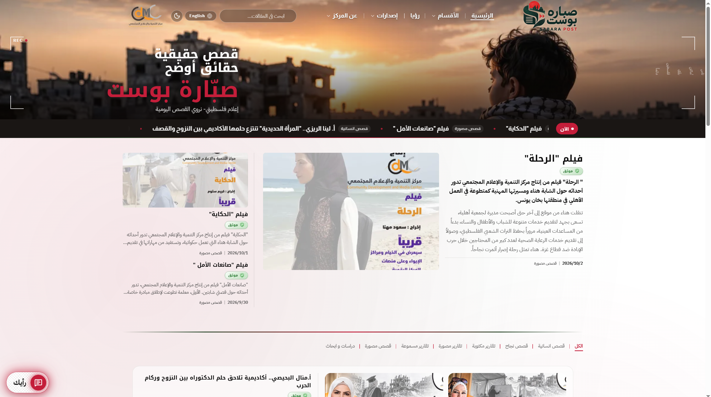
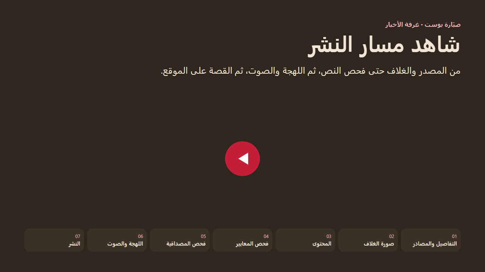

# صبّارة بوست

منصة إعلام فلسطيني من [مركز التنمية والإعلام المجتمعي](https://www.cdmc.ps/) في غزة. الموقع العام يقدّم القصص للجمهور، وغرفة الأخبار تدير التحرير والتحقق والنشر.



## مسار النشر

أغلب أدوات التحرير والتحقق والصوت تعمل داخل مسار نشر المقال. الفيديو يشرح الخطوات السبع لمقال النص: التفاصيل والمصادر، الغلاف وفحص الصورة، المحتوى وأدوات المحرر، فحص المعايير، فحص المصداقية، اللهجة والصوت، ثم النشر. الصوت والفيديو يختصران الخطوات الوسطى.

[](docs/publishing-flow.mp4)

[شاهد فيديو مسار النشر](docs/publishing-flow.mp4)

## المشكلة والفئة المستهدفة

الحرب على غزة رفعت حجم الشائعات والصور المنزوعة من سياقها. القارئ يحتاج قصة يمكن تتبّع مصدرها، والمحرّر يحتاج مسارًا يمنع نشر مادة قبل اكتمال التحقق.

المنصة تخاطب ثلاث فئات:

- **القرّاء**: جمهور عربي (مع واجهة إنجليزية) يبحث عن قصص موثّقة من غزة وفلسطين، مع مصادر ظاهرة ومؤشر ثقة.
- **فريق التحرير**: صحفيون ومحررون في المركز يجهّزون المادة، يراجعون المعايير والمصداقية، ثم ينشرونها عبر بوابات مراجعة.
- **إدارة المنصة**: من يدير الفريق والأدوار والمحتوى الثابت من لوحة الإدارة.

## أهم الميزات

- **موقع عام ثنائي اللغة**: رئيسية، مقالات، أقسام، من نحن، شركاؤنا، وتواصل. العربية من اليمين لليسار والإنجليزية من اليسار لليمين.
- **غرفة أخبار بمراحل نشر**: القصة لا تُنشر قبل اجتياز التحرير، المصادر، الغلاف، فحص المعايير، وفحص المصداقية.
- **أدوات تحقق**: البحث العكسي عن الصور، كشف الصور المولَّدة، فحص النطاقات، المعايير الصحفية، المصداقية، والتوطين.
- **صوت ونص**: تحويل النص إلى كلام، الكلام إلى نص، ومشغّل يروي المقال ويستمر أثناء التنقّل بين الصفحات.
- **ثقة القارئ**: تقييم الظاهرة وملاحظات القرّاء، مع شارة «موثّق» على القصص التي أكملت المسار.
- **ثيم داكن دافئ**: الصفحة داكنة والبطاقات تبقى بلون الورق حتى تبقى العناوين مقروءة.
- **عرض من الخادم وتحسين محركات البحث**: الصفحات العامة تُرسم على الخادم مع بيانات وصفية للمشاركة.

## تحديات تم حلّها

- **التباين في الوضع الداكن**: الخلفيات الداكنة والبطاقات الفاتحة كانتا تبتلعان العناوين والتواريخ وأسهم التنقّل. الحل فصل لون الصفحة عن لون حبر البطاقة، وتثبيت ذلك في أقسام الرئيسية ومن نحن والشركاء والأدوات.
- **المشغّل الصوتي**: إغلاق المشغّل كان يعيد تشغيل المقال لأن جلسة الاستماع تُستأنف طالما طلب التشغيل قائم. أُغلقت الجلسة فعليًا، وزر الإغلاق يوقف الصوت ويزيل الشريط.
- **الشاشات القصيرة**: شريط الاستماع كان يغطي المقال عندما يقل ارتفاع النافذة عن 860px. صار شريطًا عائمًا يتكيّف مع العرض والارتفاع.
- **بيانات البيئة التجريبية**: الواجهة المحلية والنسخة التجريبية كانتا تقرآن مصدرين مختلفين. صار الاثنان يشيران إلى واجهة الإنتاج `api.sabbarapost.org`.
- **اتجاه الواجهة**: القوائم، البحث، والشبكة التحريرية تعمل في الاتجاهين دون قلب المكوّنات المشتركة.

## التشغيل محليًا

```bash
npm install
cp .env.example .env
npm run dev
```

الموقع على `http://localhost:1573`. طلبات `/api` تُمرَّر إلى واجهة الإنتاج.

| الأمر | الوظيفة |
| --- | --- |
| `npm run dev` | واجهة Vite مع تحديث فوري |
| `npm run dev:ssr` | الواجهة مع العرض من الخادم |
| `npm run build` | بناء ملفات الإنتاج |
| `npm run build:ssr` | بناء الواجهة والخادم |
| `npm start` | تشغيل بناء الإنتاج |

## التقنيات

React 19، Vite، TypeScript، Tailwind CSS، Radix UI، TanStack Query، وExpress للعرض من الخادم. واجهة البيانات Laravel على نطاق منفصل، والرفع إلى الاستضافة عبر GitHub Actions.

خريطة المجلدات في [`src/README.md`](src/README.md).

## الرخصة

استخدام خاص. راجع [إشعار الترخيص](LICENSE).
